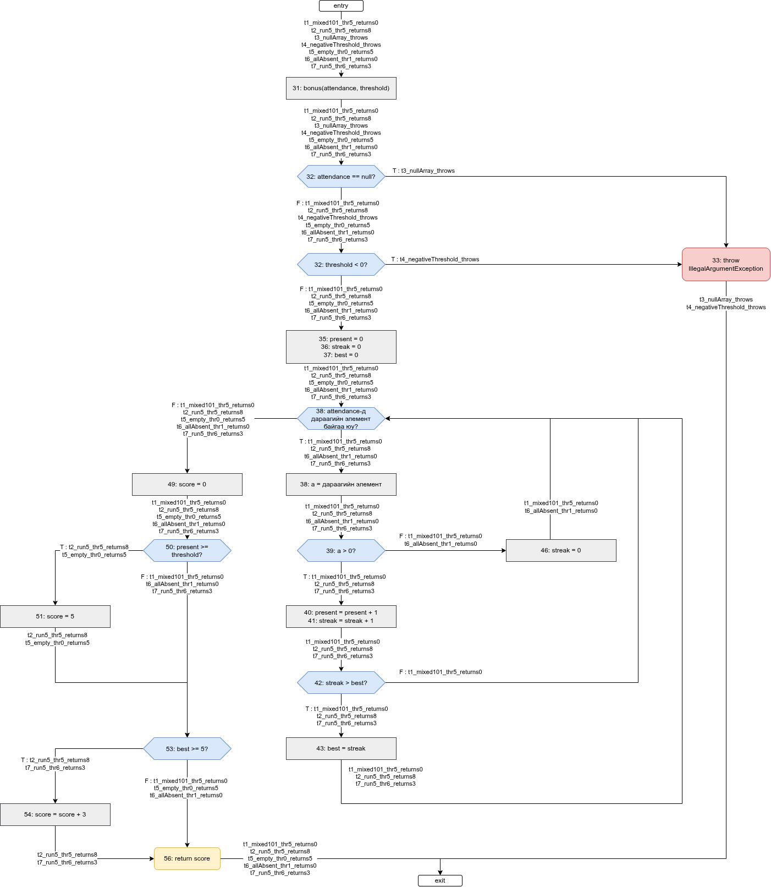

# Лаб 10 - B232270068 А.Баяржавхлан

## Хэсэг A: gcd() функцийн DU хосуудын хүснэгт

| Хувьсагч | Def мөр | Use мөр | Төрөл | Def-clear зам        | Тестийн ID           | Хамрагдсан |
| -------- | ------- | ------- | ----- | -------------------- | -------------------- | ---------- |
| x        | 13      | 16      | c-use | 13 → 15(T) → 16      | G2, G3               | ✓          |
| x        | 13      | 20      | c-use | 13 → 15(F) → 20      | **G1**               | ✓          |
| x        | 17      | 16      | c-use | 17 → 18 → 15(T) → 16 | G3                   | ✓          |
| x        | 17      | 20      | c-use | 17 → 18 → 15(F) → 20 | G2, G3               | ✓          |
| y        | 13      | 15      | p-use | 13 → 15              | T: G2, G3; F: **G1** | ✓          |
| y        | 13      | 16      | c-use | 13 → 15(T) → 16      | G2, G3               | ✓          |
| **y**    | 13      | 17      | c-use | 13 → 15(T) → 16 → 17 | G2, G3               | ✓          |
| y        | 18      | 15      | p-use | 18 → 15              | T: G3; F: G2, G3     | ✓          |
| **y**    | 18      | 16      | c-use | 18 → 15(T) → 16      | G3                   | ✓          |
| **y**    | 18      | 17      | c-use | 18 → 15(T) → 16 → 17 | G3                   | ✓          |
| tmp      | 16      | 18      | c-use | 16 → 17 → 18         | G2, G3               | ✓          |

Лекцийн хүснэгтэд байгаагүй DU хосуудыг хувьсагч баганад тодруулав.

Тестүүд (`GcdTest.java`):
- G1 = `gcd_7_0_zeroIter_returns7`
- G2 = `gcd_0_5_oneIter_returns5`
- G3 = `gcd_12_8_twoIter_returns4`.


## Хэсэг B: bonus() функц

### B1: CFG



### B2: Мөр бүрийн def/use

```java
31  public static int bonus(int[] attendance, int threshold) {  // def: attendance, threshold (параметр)
32      if (attendance == null || threshold < 0) {              // p-use: attendance, threshold (threshold нь attendance != null үед л шалгагдана)
33          throw new IllegalArgumentException("Буруу оролт");  // —
35      int present = 0;                                        // def: present
36      int streak = 0;                                         // def: streak
37      int best = 0;                                           // def: best
38      for (int a : attendance) {                              // p-use: attendance (дараагийн элемент байгаа эсэх), def: a
39          if (a > 0) {                                        // p-use: a
40              present = present + 1;                          // c-use: present, def: present
41              streak = streak + 1;                            // c-use: streak, def: streak
42              if (streak > best) {                            // p-use: streak, best
43                  best = streak;                              // c-use: streak, def: best
46              streak = 0;                                     // def: streak
49      int score = 0;                                          // def: score
50      if (present >= threshold) {                             // p-use: present, threshold
51          score = 5;                                          // def: score
53      if (best >= 5) {                                        // p-use: best
54          score = score + 3;                                  // c-use: score, def: score
56      return score;                                           // c-use: score
```

| Хувьсагч   | Def мөрүүд                                                | Use мөрүүд                         |
| ---------- | --------------------------------------------------------- | ---------------------------------- |
| attendance | 31 (параметр)                                             | 32 (p-use), 38 (p-use)             |
| threshold  | 31 (параметр)                                             | 32 (p-use), 50 (p-use)             |
| present    | 35 (эхлүүлэлт), 40 (present = present + 1)                | 40 (c-use), 50 (p-use)             |
| streak     | 36 (эхлүүлэлт), 41 (streak = streak + 1), 46 (streak = 0) | 41 (c-use), 42 (p-use), 43 (c-use) |
| best       | 37 (эхлүүлэлт), 43 (best = streak)                        | 42 (p-use), 53 (p-use)             |
| a          | 38 (дараагийн элемент)                                    | 39 (p-use)                         |
| score      | 49 (эхлүүлэлт), 51 (score = 5), 54 (score = score + 3)    | 54 (c-use), 56 (c-use)             |


### B3: DU хосуудын хүснэгт

| Хувьсагч   | Def мөр | Use мөр | Төрөл | Def-clear зам                               | Тестийн ID                               | Хамрагдсан |
| ---------- | ------- | ------- | ----- | ------------------------------------------- | ---------------------------------------- | ---------- |
| attendance | 31      | 32      | p-use | 31 → 32                                     | T: T3; F: T1, T2, T4–T7                  | ✓          |
| attendance | 31      | 38      | p-use | 31 → 32(F) → 35 → 36 → 37 → 38              | T: T1, T2, T6, T7; F: T1, T2, T5, T6, T7 | ✓          |
| threshold  | 31      | 32      | p-use | 31 → 32                                     | T: T4; F: T1, T2, T5, T6, T7             | ✓          |
| threshold  | 31      | 50      | p-use | 31 → 32(F) → 35 → 36 → 37 → 38(F) → 49 → 50 | T: T2, T5; F: T1, T6, T7                 | ✓          |
| present    | 35      | 40      | c-use | 35 → 36 → 37 → 38(T) → 39(T) → 40           | T1, T2, T7                               | ✓          |
| present    | 35      | 50      | p-use | 35 → 36 → 37 → 38(F) → 49 → 50              | T: T5; F: T6                             | ✓          |
| present    | 40      | 40      | c-use | 40 → 41 → 42(T) → 43 → 38(T) → 39(T) → 40   | T1, T2, T7                               | ✓          |
| present    | 40      | 50      | p-use | 40 → 41 → 42(T) → 43 → 38(F) → 49 → 50      | T: T2; F: T1, T7                         | ✓          |
| streak     | 36      | 41      | c-use | 36 → 37 → 38(T) → 39(T) → 40 → 41           | T1, T2, T7                               | ✓          |
| streak     | 41      | 41      | c-use | 41 → 42(T) → 43 → 38(T) → 39(T) → 40 → 41   | T2, T7                                   | ✓          |
| streak     | 41      | 42      | p-use | 41 → 42                                     | T: T1, T2, T7; F: T1                     | ✓          |
| streak     | 41      | 43      | c-use | 41 → 42(T) → 43                             | T1, T2, T7                               | ✓          |
| streak     | 46      | 41      | c-use | 46 → 38(T) → 39(T) → 40 → 41                | T1                                       | ✓          |
| best       | 37      | 42      | p-use | 37 → 38(T) → 39(T) → 40 → 41 → 42           | T: T1, T2, T7; F: биелэшгүй              | ✓          |
| best       | 37      | 53      | p-use | 37 → 38(F) → 49 → 50(F) → 53                | T: биелэшгүй; F: T5, T6                  | ✓          |
| best       | 43      | 42      | p-use | 43 → 38(T) → 39(T) → 40 → 41 → 42           | T: T2, T7; F: T1                         | ✓          |
| best       | 43      | 53      | p-use | 43 → 38(F) → 49 → 50(F) → 53                | T: T2, T7; F: T1                         | ✓          |
| a          | 38      | 39      | p-use | 38 → 39                                     | T: T1, T2, T7; F: T1, T6                 | ✓          |
| score      | 49      | 54      | c-use | 49 → 50(F) → 53(T) → 54                     | T7                                       | ✓          |
| score      | 49      | 56      | c-use | 49 → 50(F) → 53(F) → 56                     | T1, T6                                   | ✓          |
| score      | 51      | 54      | c-use | 51 → 53(T) → 54                             | T2                                       | ✓          |
| score      | 51      | 56      | c-use | 51 → 53(F) → 56                             | T5                                       | ✓          |
| score      | 54      | 56      | c-use | 54 → 56                                     | T2, T7                                   | ✓          |

Нийт 23 DU хос; p-use-ийн 24 салаанаас 22 нь биелэх боломжтой.

- **Kill:** 46-р мөр (`streak = 0`) streak@36, streak@41-ийг алдаг; present, best-д нөлөөлөхгүй. Мөн 41 нь streak@36, @46-г, 40 нь present@35-г, 43 нь best@37-г, 51 нь score@49-г, 54 нь score@49, @51-г алдаг.
- **DU хос биш (def-clear зам байхгүй):** streak 36 → 42, 36 → 43, 46 → 42, 46 → 43. 42, 43-р мөрт хүрэх зам бүр 41-ээр дамжиж streak-г дахин тодорхойлдог.
- **Зөвхөн тодорхой замаар хамрагдах:** streak 41 → 41 нь зөвхөн дараалсан ирцээр (46-аар дамжвал kill); present 35 → 50, best 37 → 53 нь ирсэн өдөр огт байхгүй үед (40, 43 ажиллахгүй); score 49 → 54/56 нь зөвхөн 50(F) үед.
- **Биелэшгүй салаа:**
  - best 37 → 42 (F): 42-т анх хүрэхэд best = 0, streak ≥ 1 тул нөхцөл заавал T болж 43 best-г шууд дахин тодорхойлно.
  - best 37 → 53 (T): best шинэчлэгдээгүй бол 0 бөгөөд 0 ≥ 5 үргэлж худал.

### B4: All-defs тестүүд (`BonusTest.java`)

| ID  | Тестийн метод               | Оролт                  | Хүлээгдэх |
| --- | --------------------------- | ---------------------- | --------- |
| T1  | `t1_mixed101_thr5_returns0` | `([1, 0, 1], 5)`       | 0         |
| T2  | `t2_run5_thr5_returns8`     | `([1, 1, 1, 1, 1], 5)` | 8         |

13 def-ээс 13 нь use-д хүрсэн, DU хос 19/23. Хамгийн багадаа 2 тест хэрэгтэй: score@49 зөвхөн 50(F)-ээр use-д хүрнэ (50(T) бол 51 алдаг), score@51 зөвхөн 50(T) үед үүснэ. 50-р мөр нэг дуудалтад нэг л удаа бодогддог тул нэг тест хоёуланг нь хангаж чадахгүй.

`results/mvn-verify-alldefs.txt`: `Tests run: 5, Failures: 0, Errors: 0, Skipped: 0`. `results/jacoco-alldefs.csv`: BRANCH 14/16 (missed 2), LINE 22/24 (missed 2).

### B4: All-DU-pairs тестүүд

| ID  | Тестийн метод                 | Оролт                  | Хүлээгдэх | Шинээр хамарсан                          |
| --- | ----------------------------- | ---------------------- | --------- | ---------------------------------------- |
| T3  | `t3_nullArray_throws`         | `(null, 0)`            | exception | attendance 31 → 32 (T)                   |
| T4  | `t4_negativeThreshold_throws` | `([1], -1)`            | exception | threshold 31 → 32 (T)                    |
| T5  | `t5_empty_thr0_returns5`      | `([], 0)`              | 5         | present 35 → 50, best 37 → 53, score 51 → 56 |
| T6  | `t6_allAbsent_thr1_returns0`  | `([0, 0], 1)`          | 0         | present 35 → 50 (F)                      |
| T7  | `t7_run5_thr6_returns3`       | `([1, 1, 1, 1, 1], 6)` | 3         | score 49 → 54                            |

DU хос 23/23, биелэх боломжтой p-use салаа 22/22.

Branch 100% ≠ all-DU-pairs: `GcdTest#gcd_12_8` + T1–T4 (5 тест) ажиллуулахад `results/jacoco-branch-only.csv`: BRANCH 16/16 (missed 0) боловч 5 DU хос хамрагдаагүй: gcd x 13 → 20, bonus present 35 → 50, best 37 → 53, score 49 → 54, score 51 → 56.
